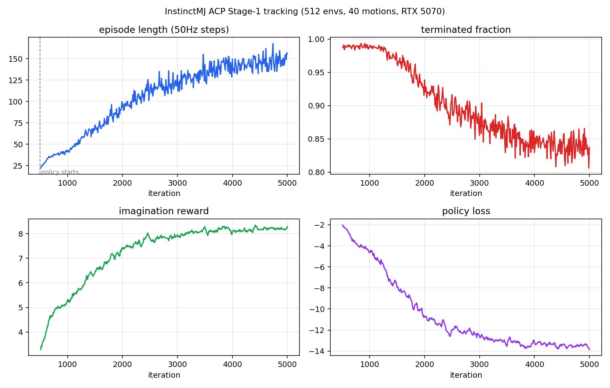

# InstinctMJ ACP 复现包（Unitree G1 · 单卡 RTX 5070）

在**单张 12GB 消费级显卡**上复现 [InstinctMJ](https://github.com/project-instinct/InstinctMJ) 的 `acp` 分支
（ACP = Attention-based Contact Planning，训练侧用 **SuperMimic** 的可微世界模型 + BPTT）。

官方分支**没有发布数据集**，本仓库补齐了从公开数据到可训练格式的完整链路、单卡适配补丁，以及踩过的坑。

---

## 1. 结果摘要

Stage-1（接触条件化 tracker），40 条 LAFAN1-G1 动作，512 envs，5000 轮，约 2 小时。

| 指标 | 随机策略 (0) | 5000 轮 |
|---|---|---|
| `sim/episode_length` | 23 步 (0.46 s) | **155.8 步 (3.1 s)** |
| `sim/terminated_fraction` | 0.99 | **0.837** |
| `imagination/survival` (32 步) | — | **0.795** |
| `imagination/reward` | — | **8.29** |
| `policy/loss` | — | **-13.85** |



原始标量见 [`results/metrics.csv`](results/metrics.csv)。策略在 MuJoCo 里能连续走两三步，
但 `terminated_fraction` 仍有 0.84，说明**尚未真正学会稳定行走**（见 §7 已知限制）。

---

## 2. 硬件与软件

| 项 | 实测配置 |
|---|---|
| GPU | RTX 5070 12GB（Blackwell, sm_120） |
| 系统 | Ubuntu, Python 3.12 |
| 关键依赖 | torch 2.10+cu128, mujoco 3.11, mujoco-warp, warp-lang 1.14, mjlab v1.6.0 |
| 环境管理 | uv |

显存实测：512 envs + BPTT 策略阶段 ≈ 9.1 GB / 12 GB。

---

## 3. 快速开始

```bash
# 0) 目录约定：mjlab 必须与 InstinctMJ 同级
mkdir -p ~/code && cd ~/code
git clone -b v1.6.0 https://github.com/mujocolab/mjlab.git
git clone -b acp    https://github.com/project-instinct/InstinctMJ.git
cd InstinctMJ && uv sync

# 1) 打本地适配补丁（相机跟随 + 重置采样，见 §6）
git apply /path/to/instinctmj-acp-repro/patches/0001-local-fixes.patch

# 2) 下载公开数据（Unitree LAFAN1 重定向到 G1，30fps CSV）
bash scripts/01_download_data.sh ~/Datasets/LAFAN1_Retargeting

# 3) CSV -> ACP npz（30 -> 50Hz，四元数重排为 wxyz）
python scripts/02_csv_to_acp_npz.py \
  ~/Datasets/LAFAN1_Retargeting/g1 \
  ~/Datasets/acp/acp_motions_v1_50hz/flat

# 4) 生成平地地形（STL + SDF 解析几何）
python scripts/03_make_flat_terrain.py ~/Datasets/acp/acp_motions_v1_50hz

# 5) 生成 metadata，并打接触标签（在 InstinctMJ 根目录执行）
uv run instinct-motion-metadata --path ~/Datasets/acp/acp_motions_v1_50hz
uv run python -m instinct_mj.scripts.acp.label_contacts \
  --dataset ~/Datasets/acp/acp_motions_v1_50hz --overwrite

# 6) 自检 -> 训练 -> 播放
python scripts/04_check_dataset.py ~/Datasets/acp/acp_motions_v1_50hz
./scripts/05_run_training.sh
./scripts/06_play_policy.sh <run目录名> model_5000.pt
```

想直接看效果、不想训练？仓库里带了 `assets/model_5000.pt`，把它拷进任意 run 目录即可播放：

```bash
mkdir -p logs/instinct_rl/demo/2026-01-01_00-00-00_demo
cp assets/model_5000.pt logs/instinct_rl/demo/2026-01-01_00-00-00_demo/
./scripts/06_play_policy.sh demo/2026-01-01_00-00-00_demo model_5000.pt
```

TensorBoard（注意：**不要用 `uv run`**，见 §6.7）：

```bash
.venv/bin/tensorboard --logdir logs/instinct_rl --port 6006 --bind_all
```

---

## 4. 数据集制作

### 4.1 为什么需要自己造

`acp` 分支 README 明确写着 **"The datasets are not released with this branch."**
Google Drive 上只有预训练权重，没有数据。所以必须从公开动捕数据自制。

### 4.2 源数据

| 数据源 | 用途 | 地址 |
|---|---|---|
| Unitree LAFAN1_Retargeting_Dataset | **本仓库采用**：G1 全身动作，30fps CSV | HuggingFace `lvhaidong/LAFAN1_Retargeting_Dataset` |
| BeyondMimic | 备选（已是 npz），转换脚本可参考 | UC Berkeley Hybrid Robotics |
| OmniRetarget | 带地形 mesh 的攀爬数据（本包未用） | HybridRobotics |

### 4.3 目录结构

```
~/Datasets/acp/acp_motions_v1_50hz/
├── metadata.yaml                     # 动作清单 + 地形映射
└── flat/                             # 每个地形一个目录
    ├── flat.stl                      # 封闭立方体，顶面 z=0
    ├── flat.geoms.yaml               # SDF 解析几何，必须与 STL 一致
    ├── walk1_subject1_retargeted.npz
    ├── walk1_subject1_retargeted.contacts.npz
    └── ...
```

### 4.4 动作 npz 格式（5 个必需 key）

| key | shape | 说明 |
|---|---|---|
| `framerate` | () | **必须 50.0**（ACP 策略 50Hz，PD 200Hz） |
| `joint_names` | (J,) | 29 个 G1 关节名，按名字匹配，顺序无关 |
| `joint_pos` | (T, J) | 弧度 |
| `base_pos_w` | (T, 3) | 骨盆世界坐标，**米**（不是厘米） |
| `base_quat_w` | (T, 4) | **wxyz** 顺序（源 CSV 是 xyzw，必须重排） |

### 4.5 接触标签 `.contacts.npz`

由 `label_contacts` 生成，9 个接触体（pelvis、双腕、双肘、双膝、双踝）：

| key | shape |
|---|---|
| `framerate` | () |
| `body_names` | (9,) |
| `contact_flag` | (T, 9) bool |
| `contact_pos_w` | (T, 9, 3) float32，无接触处为 0 |

> 若环境配置为 `simplified_collision=True`（v1 默认），标签必须加 `--simplified-collision`
> 重新生成，否则碰撞模式不匹配。

---

## 5. 单卡适配

| 参数 | 原论文 | 本仓库 | 原因 |
|---|---|---|---|
| envs | 4096 | 512（768 可跑） | 12GB 显存不够 |
| `--env.sim.nconmax` | 默认 | **64** | 见 §6.2，**提速 2.5 倍** |
| `max_resample` | 3 | **0** | 重置探测吃 4GB 显存，见 §6.3 |

环境数吞吐实测（40 条动作）：

| envs | 100 轮耗时 | 相对吞吐 |
|---|---|---|
| 256 | 5 分 00 秒 | 1.0× |
| 512 | 2 分 22 秒 | 3.6× |
| 768 | 2 分 00 秒 | 6.4× |

**环境数越少不一定越快**：`nconmax` 配错时，小环境数反而更慢。

---

## 6. 踩过的坑（按重要性排序）

### 6.1 必须关闭 self-collision

机器人碰撞 geom 设 `contype=2 / conaffinity=1`，地形设 `contype=1 / conaffinity=2`，
则机器人部件之间不碰撞（2 & 1 = 0），但机器人与地形碰撞。开着自碰撞会引入 906 对约束，
导致训练卡死或发散。这是上游 `assets/acp_g1.py` 的默认行为，**不要改**。

### 6.2 `nconmax` 默认值过大 → 又慢又吃显存

每个 env 预留的接触点缓冲区过大，既占显存又让碰撞检测空转。设为 64 后：

- 512 envs 显存 4.9GB（原默认直接 OOM）
- 100 轮从 5:00 降到 2:22

```bash
--env.sim.nconmax 64
```

### 6.3 重置时的 4GB 临时探测

`EventTermCfg` 在 reset 时建私有模型做穿地探测，40 条动作时要申请 4GB，直接 OOM。
把 `max_resample` 设为 0（`patches/0001-local-fixes.patch`）——合法起始帧筛选已保证不穿地。

### 6.4 策略前 500 轮是 NaN，这是正常的

`wm_only_iters = 500`：前 500 轮**只训世界模型**，策略指标（`pi/v/imag_r/surv`）在没有数据时
主动返回 `nan`。不要据此判断发散。第 500 轮后才开始策略训练。

### 6.5 策略阶段显存会涨

世界模型阶段 5.4GB，进入策略阶段（32 步 BPTT 要存中间量）涨到 9.1GB。
此时**不能再开回放窗口**，否则 `Warp CUDA error 2: out of memory`。

### 6.6 回放窗口看不到机器人

`G1AcpTrackV1EnvCfg_PLAY` 的相机默认 `origin_type=WORLD`，固定盯着世界原点，
机器人随机初始位置后走远就出画。改为 `ASSET_BODY` + `body_name="torso_link"` 即可跟随。

### 6.7 不要用 `uv run tensorboard`

`uv run` 会按 `uv.lock` 把环境还原，setuptools 回到 82 版（该版本**移除了 `pkg_resources`**），
TensorBoard 2.20 直接报 `ModuleNotFoundError`。用 `.venv/bin/tensorboard` 直连。

### 6.8 续训参数语义

- `--agent.load-run` 要的是 **run 子目录名**（如 `2026-11-15_21-41-47_g1AcpTrackV1_supermimic`），
  不是完整路径；配 `--agent.experiment-name` 指定实验目录
- `--checkpoint-file` 必须是**绝对路径**
- 续训必须同时有 `model_*.pt` 和 `acp_state_*.pt`（后者含世界模型、critic、优化器）

### 6.9 修改 reward / termination / observation 后

必须同步修改 `src/instinct_mj/rl/acp/mdp.py`（Stage 3 是 `stage3_mdp.py`）里对应的解析实现，
否则 env 与 imagination 的 MDP 不一致，想象轨迹会失真。

---

## 7. 已知限制

1. **数据是替代品**：官方 ACP 语料（13.2 分钟、含台阶/攀爬地形）未公开，本包用 LAFAN1 平地动作替代，
   所以**只能复现 Stage-1 的平地跟踪**，无法复现原论文的地形穿越能力
2. **环境数只有 1/8**：4096 → 512，样本吞吐低一个数量级，需要更多轮数才能收敛
3. **尚未收敛**：5000 轮时 `terminated_fraction` 仍 0.84，`track_contact_label` 仅 0.46/5.0，
   落脚时机没学会；需要 15k+ 轮
4. **sm_120 兼容性摩擦**：warp 偶发 `CUDA error 100`（子进程拿不到 GPU），不影响主流程
5. **奖励权重可疑**：`dof_pos_limits = -10.0` 权重偏高，可能压制迈步幅度，尚未做消融

---

## 8. 文件说明

```
├── README.md
├── patches/0001-local-fixes.patch   # 对上游的 2 处单卡适配修改
├── scripts/
│   ├── 01_download_data.sh          # 下载 Unitree LAFAN1-G1 CSV
│   ├── 02_csv_to_acp_npz.py         # 30→50Hz + 四元数 xyzw→wxyz
│   ├── 03_make_flat_terrain.py      # 平地 STL + SDF geoms
│   ├── 04_check_dataset.py          # 训练前自检（7 类检查）
│   ├── 05_run_training.sh           # 单卡训练/续训封装
│   ├── 06_play_policy.sh            # 播放策略（相机跟随）
│   ├── play_reference.py            # 回放参考动作（不经策略）
│   └── live_view.sh                 # 训练中循环加载最新 checkpoint
├── assets/
│   ├── model_5000.pt                # 5000 轮训练好的 Stage-1 策略（可直接 play）
│   ├── flat.stl                     # 29x18x0.5 m 封闭立方体
│   ├── flat.geoms.yaml              # box 解析几何
│   └── metadata.example.yaml        # 40 条动作的 metadata 样例
└── results/
    ├── metrics.csv                  # 450 个采样点的全部标量
    └── training_curves.png
```

> 数据集（241MB）与训练日志（4.1GB）不入库：数据可完全由脚本从公开源重建，
> 日志请用 TensorBoard 观察，标量已导出为 `results/metrics.csv`。

---

## 9. 引用

```bibtex
@software{instinctmj_acp,
  title  = {InstinctMJ (acp branch)},
  author = {Project Instinct},
  url    = {https://github.com/project-instinct/InstinctMJ}
}
```

LAFAN1 原始动捕来自 Ubisoft La Forge；G1 重定向版本由 Unitree 发布。
本仓库仅包含复现脚本与配置，不包含上述数据的原始文件。
